# kondor

An improved [kondo](https://github.com/tbillington/kondo) that cleans build artifacts
(`target`, `node_modules`, `__pycache__`, ...) from software projects.



## Compared to kondo

What kondor does differently:

- **Nested projects are found.** kondo stops descending once it finds a project, so a Node
  frontend inside a Cargo workspace is missed. kondor keeps scanning below every project and only
  skips the artifact directories themselves, so it does not report every package inside
  `node_modules` as a separate project.
- **Custom artifacts per directory.** A [`.kondor` file](#custom-artifacts) adds glob patterns
  for generated directories that no built-in type knows about. kondo's artifact lists are fixed.
- **One key per answer.** The prompt reacts to a single key press (`y`, `n`, `a`, `q`) or the
  arrow keys, without Enter. Each answered project is left as one line with its freed size or
  `skipped`.
- **Read-only directories can be removed.** Some build outputs contain read-only directories;
  with `--force` kondor makes them writable before removing them.
- **Other project types.** Bun, Deno, KiCad, Meson, Go (`vendor`) and Ruby (`.bundle`,
  `vendor/bundle`) are detected, and Python projects are found by their project files and also
  clean `.venv`, `venv`, `build` and `dist`.
- **Excludes are glob patterns.** `--exclude` takes patterns like `'**/vendor'` or `work/*`, and
  an excluded artifact is kept too, so `--exclude '**/target'` cleans everything except `target`
  directories. kondo's `--ignored-dirs` takes only plain directory paths and skips the projects
  in them.
- **Failures are reported.** The exit code is 1 when something could not be removed, and the
  freed total also counts directories that were only partly removed.

What kondo has and kondor does not:

- a GUI (`kondo-ui`)
- `--follow-symlinks`, `--same-filesystem` and `--quiet`
- Unity, Unreal Engine, Godot, Jupyter, Turborepo, Terraform, React Native, CocoaPods and Pixi
  projects

## Install

On Fedora, install it from the
[gblachx/apps](https://copr.fedorainfracloud.org/coprs/gblachx/apps/) COPR repository:

```sh
sudo dnf copr enable gblachx/apps
sudo dnf install kondor
```

With Cargo:

```sh
# From source
cargo install kondor

# Prebuilt binary
cargo binstall kondor

# From a clone of this repository
cargo install --path .
```

## Usage

```text
Usage: kondor [-y] [-n] [-f] [-o <age>] [-e <pattern...>] [<dirs...>]

Arguments:
  dirs                     Directories to scan (default: current directory).

Options:
  -y, --yes                Clean all found projects without asking.
  -n, --dry-run            List what would be cleaned without removing anything.
  -f, --force              Make read-only directories writable so they can be
                           removed.
  -o, --older <age>        Only clean projects with no file changed for this
                           long, e.g. 20d. Units: m, h, d, w, M (30 days), y
                           (365 days).
  -e, --exclude <pattern>  Skip directories whose path matches one of these glob
                           patterns, with everything in them. Takes every
                           argument up to the next option or `--`, so put the
                           directories to scan first.
  -h, --help               Show this help message and exit.
```

Projects are handled as soon as they are found, so nothing is buffered while scanning. For each
project kondor shows its path, type, artifact directories and their sizes, then asks what to do:

```text
Clean ./api/frontend (Node)?
  .next          36.2 MiB
  node_modules  392.9 MiB

   Yes     No     All     Quit
```

| Key            | Action                                      |
| -------------- | ------------------------------------------- |
| `y`            | Clean this project                          |
| `n`            | Skip this project                           |
| `a`            | Clean this project and all remaining ones   |
| `q`, Esc       | Stop scanning                               |
| ←/→ or `h`/`l` | Move between the buttons                    |
| Enter          | Confirm the selected button (default is No) |

After the answer the prompt shrinks to one line with the result, and a total is printed at the
end:

```text
Clean ./api (Cargo)? 1.8 GiB
Clean ./api/frontend (Node)? 429.2 MiB
Clean ./legacy (Go)? skipped
Freed 2.2 GiB
```

The prompt needs an interactive terminal; use `--yes` to clean everything without asking. Then
each project is printed as `Cleaned ./api (Cargo) 1.8 GiB`. Results and the total go to stdout,
errors to stderr. The exit code is 1 when an artifact could not be removed.

`--dry-run` only lists what would be cleaned, without asking or removing anything, so it also
works without a terminal:

```text
Would clean ./api (Cargo) 1.8 GiB
Would clean ./api/frontend (Node) 429.2 MiB
Would free 2.2 GiB
```

`--older` leaves out projects that were used recently. A project's age is the time since the
newest change to any file in it, so editing the code, building it or working in a nested project
all make it recent. Hidden directories like `.git` do not count, but hidden artifacts like
`.venv` do. Directories' own modification times are ignored, because removing an artifact
updates them.

`--exclude` skips directories whose path matches a glob pattern, together with everything in
them. The path is relative to the current directory or absolute,
so `--exclude work/api` skips only that one directory. `*` matches within one path level and `**`
matches any number of levels: `--exclude 'work/*'` skips every directory directly in `work`, and
`--exclude '**/vendor'` skips every `vendor` directory. An excluded artifact is kept too:
`--exclude '**/target'` cleans everything except `target` directories.

`--exclude` takes every argument up to the next option or `--`, so several excludes can follow
one `--exclude`. Because of that, directories to scan must come first or after `--`:

```sh
kondor ~/projects --exclude work/api '**/vendor'
kondor --exclude work/api '**/vendor' -- ~/projects
```

This also makes unquoted patterns work. The shell replaces `--exclude work/*` with the names
that match, and each of them becomes an exclude. Quote a pattern to pass it to kondor as it is,
which is needed for `**` and for patterns that match nothing in the current directory. To match
a `*`, `?` or `[` that is part of a directory name, escape it as `\*` or `[*]`.

Symlinks are never followed. Hidden directories (names starting with `.`) are not scanned,
because they mostly hold tool data like `.git`, `~/.cache` or installed editor plugins, which look
like projects but must not be cleaned. Hidden artifacts like `.next` or `.venv` are still found,
and a hidden directory given as an argument (`kondor ~/.config/nvim`) is scanned.

## Supported projects

A directory is a project when it contains one of the marker files (`*` matches by suffix).
Python's `__pycache__` directories are cleaned at any depth below the project. Python's `build`
and `dist` are cleaned only when they hold nothing but packaging output: `lib`, `lib.*`,
`bdist.*`, `temp.*` and `scripts-*` directories in `build`, and `*.whl`, `*.tar.gz`, `*.zip`
and `*.egg` files in `dist`.
Artifacts are directories, except KiCad's `fp-info-cache` and `*-bak`, which are files.
A directory with Bun or Deno markers is not also reported as Node.
A `Makefile` counts only when no other marker is found, because projects of any type can have one.

| Type    | Markers                                                                                 | Artifacts                                                                                                                     |
| ------- | --------------------------------------------------------------------------------------- | ----------------------------------------------------------------------------------------------------------------------------- |
| Bun     | `bun.lock`, `bun.lockb`, `bunfig.toml`                                                  | `node_modules`, `.angular`, `.astro`, `.next`, `.nuxt`, `.parcel-cache`, `.svelte-kit`, `.turbo`, `.vite`                     |
| C/C++   | `CMakeLists.txt`, `Makefile`                                                            | `build`, `cmake-build-debug`, `cmake-build-release`                                                                           |
| Cargo   | `Cargo.toml`                                                                            | `target`                                                                                                                      |
| Dart    | `pubspec.yaml`                                                                          | `.dart_tool`, `build`                                                                                                         |
| Deno    | `deno.json`, `deno.jsonc`                                                               | `node_modules`, `vendor`, `.angular`, `.astro`, `.next`, `.nuxt`, `.parcel-cache`, `.svelte-kit`, `.turbo`, `.vite`           |
| Elixir  | `mix.exs`                                                                               | `_build`, `deps`                                                                                                              |
| Go      | `go.mod`                                                                                | `vendor`                                                                                                                      |
| Gradle  | `build.gradle`, `build.gradle.kts`                                                      | `build`, `.gradle`                                                                                                            |
| Haskell | `stack.yaml`, `cabal.project`, `*.cabal`, `package.yaml`                                | `.stack-work`, `dist-newstyle`                                                                                                |
| KiCad   | `*.kicad_pro`                                                                           | `*-backups`, `fp-info-cache`, `*.kicad_pcb-bak`, `*.kicad_sch-bak`                                                            |
| Maven   | `pom.xml`                                                                               | `target`                                                                                                                      |
| Meson   | `meson.build`                                                                           | `build`, `builddir`, `_build`                                                                                                 |
| .NET    | `*.csproj`, `*.fsproj`, `*.vbproj`                                                      | `bin`, `obj`                                                                                                                  |
| Node    | `package.json`                                                                          | `node_modules`, `.angular`, `.astro`, `.next`, `.nuxt`, `.parcel-cache`, `.svelte-kit`, `.turbo`, `.vite`                     |
| PHP     | `composer.json`                                                                         | `vendor`                                                                                                                      |
| Python  | `pyproject.toml`, `setup.py`, `setup.cfg`, `requirements.txt`, `Pipfile`, `poetry.lock` | `__pycache__`, `.venv`, `venv`, `.mypy_cache`, `.pytest_cache`, `.ruff_cache`, `.tox`, `.eggs`, `*.egg-info`, `build`, `dist` |
| Ruby    | `Gemfile`                                                                               | `.bundle`, `vendor/bundle`                                                                                                    |
| Scala   | `build.sbt`                                                                             | `target`, `project/target`                                                                                                    |
| Swift   | `Package.swift`                                                                         | `.build`, `.swiftpm`                                                                                                          |
| Zig     | `build.zig`                                                                             | `zig-cache`, `.zig-cache`, `zig-out`                                                                                          |

## Custom artifacts

A `.kondor` file adds artifacts to the directory it is in, on top of the autodetected ones. A
directory with only a `.kondor` file is a project too. Each line is a glob pattern relative to
that directory (`*`, `?`, `[abc]`, `{a,b}` in any path part, no `**`). Patterns match
directories, and the last part can also match files. Blank lines and lines starting with `#`
are ignored.

A line starting with `!` is an exclude: matching artifacts, built-in or custom, are kept. Use it
for a directory with an artifact name that holds real files, like a hand-written `build`.
kondor still scans inside an excluded directory, so projects in it are found.

```text
# Generated by our codegen
generated/
logs/*.log
packages/*/dist

# Our build directory holds hand-written scripts
!build
```

Absolute paths and paths with `.` or `..` are ignored, and patterns never match through
symlinks, so a `.kondor` file cannot remove anything outside its directory.

## Caution

Some artifact names can also be used for real source directories:

- Go `vendor` is sometimes committed to git (restore with `go mod vendor`).
- `build` in C/C++ and Meson projects may contain hand-written files.
- KiCad `*-backups` holds the only copies of earlier versions of the design.

Review the list before answering `y`, and be careful with `--yes`. To keep such a directory, add
an [exclude](#custom-artifacts) for it to a `.kondor` file.

## Demo animation

`docs/demo.svg` is recorded by `docs/demo.py`, which runs kondor on a generated demo tree in a
pseudo terminal and saves every screen as one frame of an animated SVG:

```sh
cargo build
uv venv
uv pip install pyte
.venv/bin/python docs/demo.py
```

## License

kondor is licensed under the [GNU General Public License v3.0 or later](LICENSE).
